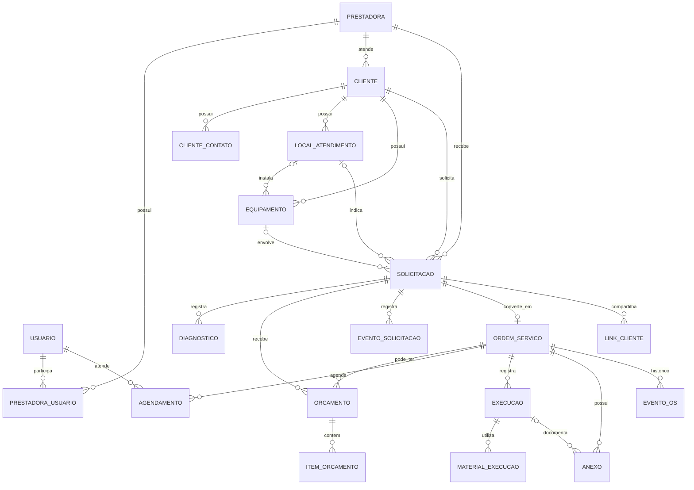

# Modelo lógico de dados — AgServPro

**Status:** proposta para revisão; ainda não convertida em migrations.  
**Banco aprovado:** PostgreSQL.  
**Escopo:** entidades do MVP e vínculos entre prestadora, atendimento, orçamento, agenda e execução.

Este documento detalha o modelo conceitual citado em [architecture.md](../architecture.md). Os tipos e constraints são recomendações para orientar a implementação. Decisões abertas estão listadas ao final.

## Premissas do modelo

- A solicitação é um registro próprio durante a entrada, triagem e orçamento. A OS é criada depois da triagem e, quando necessária, da aprovação do orçamento.
- A solicitação pode ficar incompleta, sem local ou equipamento, conforme RN-01. Cliente, relato e origem bastam para registrá-la.
- Cada solicitação pode originar no máximo uma OS. O orçamento inicial pertence à solicitação; orçamentos adicionais permanecem associados à solicitação e à OS já criada.
- Uma OS pode ter vários agendamentos e registros de execução, permitindo reagendamento e visitas de retorno com histórico.
- Cada registro operacional pertence a uma prestadora. O backend obtém o escopo a partir da identidade autenticada, nunca de um `prestadora_id` aceito do navegador.
- Usuários e prestadoras são entidades separadas; a associação ocorre por `prestadora_usuario`.

## Diagrama

A solicitação exige um cliente, mas pode não ter local ou equipamento no registro inicial. A OS referencia a solicitação de origem e só passa a existir depois da triagem e das aprovações necessárias.

## Entidades e responsabilidades

Tipos indicados são PostgreSQL. IDs usam `uuid`; datas e horários usam `timestamptz`; valores monetários usam `numeric(12,2)`.

| Tabela | Campos principais | Regras e vínculos |
|---|---|---|
| `prestadora` | `id`, `nome`, `status`, `fuso_horario`, `criado_em`, `atualizado_em` | Raiz de propriedade dos dados operacionais. |
| `usuario` | `id`, `nome`, `email`, `status`, `criado_em` | Identidade de acesso. Unicidade e normalização de e-mail dependem da decisão de autenticação. |
| `prestadora_usuario` | `prestadora_id`, `usuario_id`, `papel`, `status`, `criado_em` | Associação do usuário à prestadora; chave única `(prestadora_id, usuario_id)`. Papéis iniciais candidatos: gestor e técnico. |
| `cliente` | `id`, `prestadora_id`, `nome`, `observacoes`, `criado_em`, `atualizado_em` | Cadastro do cliente dentro da prestadora. |
| `cliente_contato` | `id`, `prestadora_id`, `cliente_id`, `nome`, `telefone`, `email`, `principal` | Um cliente pode ter mais de um contato. Telefone não deve ser chave única sem regra aprovada. |
| `local_atendimento` | `id`, `prestadora_id`, `cliente_id`, `apelido`, `cep`, `logradouro`, `numero`, `complemento`, `bairro`, `cidade`, `uf`, `referencia` | Endereço pertencente ao cliente; pode faltar na abertura rápida. |
| `equipamento` | `id`, `prestadora_id`, `cliente_id`, `local_id`, `tipo`, `marca`, `modelo`, `numero_serie`, `observacoes` | Equipamento pertence ao cliente e pode ser associado a um local. Modelo/serial podem estar ausentes inicialmente. |
| `solicitacao` | `id`, `prestadora_id`, `cliente_id`, `local_id`, `equipamento_id`, `aberta_por`, `canal_origem`, `servico_solicitado`, `relato_cliente`, `status`, `criado_em`, `atualizado_em`, `encerrada_em`, `motivo_encerramento`, `cancelada_em`, `motivo_cancelamento` | Registro inicial do pedido, triagem e dados de origem. Cliente e relato são obrigatórios; local/equipamento são opcionais. Não é uma OS. |
| `ordem_servico` | `id`, `prestadora_id`, `solicitacao_id`, `numero`, `status`, `criada_por`, `criado_em`, `atualizado_em`, `cancelada_em`, `motivo_cancelamento` | Criada somente após triagem e orçamento aprovado quando necessário. `solicitacao_id` é único por prestadora; os dados da solicitação são consultados pela relação, sem duplicação. |
| `diagnostico` | `id`, `prestadora_id`, `solicitacao_id`, `registrado_por`, `descricao`, `criado_em` | Registra triagem/diagnóstico antes da criação da OS, separado do relato do cliente. |
| `orcamento` | `id`, `prestadora_id`, `solicitacao_id`, `ordem_servico_id`, `orcamento_origem_id`, `tipo`, `versao`, `status`, `validade_ate`, `enviado_em`, `respondido_em`, `forma_resposta`, `observacao_resposta`, `criado_por` | O orçamento inicial pertence à solicitação; `ordem_servico_id` fica vazio até a conversão. Orçamentos adicionais vinculam-se também à OS. Manter registros anteriores preserva versões e aprovações. |
| `item_orcamento` | `id`, `prestadora_id`, `orcamento_id`, `descricao`, `quantidade`, `valor_unitario`, `ordem` | Preço é uma fotografia da proposta; não depende de catálogo de estoque, que está fora do MVP. Total calculado pela soma dos itens. |
| `agendamento` | `id`, `prestadora_id`, `ordem_servico_id`, `tecnico_usuario_id`, `tipo`, `inicio_em`, `fim_em`, `status`, `observacao`, `criado_por` | `tipo`: inicial ou retorno. Cancelados deixam de ocupar horário; reagendamentos ficam no histórico. |
| `execucao` | `id`, `prestadora_id`, `ordem_servico_id`, `agendamento_id`, `tecnico_usuario_id`, `diagnostico`, `servico_realizado`, `resultado`, `recebido_por`, `iniciada_em`, `finalizada_em`, `confirmada_em` | Registra o que foi feito e seu resultado. Pode haver vários registros por OS em caso de retorno. |
| `material_execucao` | `id`, `prestadora_id`, `execucao_id`, `descricao`, `quantidade`, `unidade` | Registra materiais usados como descrição e quantidade; não movimenta estoque. |
| `anexo` | `id`, `prestadora_id`, `ordem_servico_id`, `execucao_id`, `chave_objeto`, `nome_original`, `tipo_mime`, `tamanho_bytes`, `enviado_por`, `criado_em` | Arquivo binário fica em armazenamento de objetos; banco guarda metadados e vínculo. |
| `evento_solicitacao` | `id`, `prestadora_id`, `solicitacao_id`, `tipo`, `status_anterior`, `status_novo`, `descricao`, `registrado_por`, `criado_em` | Histórico da entrada, triagem, decisões de orçamento, conversão e encerramento da solicitação. |
| `evento_os` | `id`, `prestadora_id`, `ordem_servico_id`, `tipo`, `status_anterior`, `status_novo`, `descricao`, `registrado_por`, `criado_em` | Histórico da OS, incluindo cancelamento e reagendamento. |
| `link_cliente` | `id`, `prestadora_id`, `solicitacao_id`, `token_hash`, `expira_em`, `revogado_em`, `criado_em` | Armazena hash do token, nunca o token em texto puro. O link acompanha orçamento e, após conversão, a OS relacionada; política de expiração e escopo ainda precisa ser definida. |

## Regras de integridade e isolamento

1. Toda tabela operacional deve conter `prestadora_id`.
2. Referências entre tabelas operacionais devem validar a mesma prestadora. Recomenda-se unicidade composta, por exemplo `UNIQUE (prestadora_id, id)`, e FKs compostas como `(prestadora_id, cliente_id)`.
3. `prestadora_usuario` deve validar o vínculo do usuário à prestadora antes de permitir atribuição como técnico, abertura ou edição de registros.
4. O escopo da prestadora deve vir da identidade autenticada no backend; não aceitar o escopo do corpo ou dos parâmetros enviados pelo frontend.
5. O cancelamento deve preservar a OS e seu histórico. Não apagar registros para representar cancelamento.
6. O estado do orçamento deve ser separado do estado da OS, permitindo orçamento recusado sem encerrar automaticamente a OS.
7. A conclusão deve exigir resultado e confirmação do recebimento, conforme RN-07 e TA-12.
8. Para impedir sobreposição concorrente no PostgreSQL, recomenda-se constraint de exclusão por `prestadora_id`, `tecnico_usuario_id` e intervalo `[inicio_em, fim_em)`, ignorando agendamentos cancelados. A validação apenas na tela não garante a regra RN-10 sob requisições simultâneas.

## Índices iniciais

- `prestadora_usuario (usuario_id, status)` para resolver as prestadoras disponíveis ao usuário.
- `cliente (prestadora_id, nome)` para pesquisa de clientes.
- `cliente_contato (prestadora_id, telefone)` para localizar cliente pelo telefone; sem unicidade até haver regra contra duplicados.
- `equipamento (prestadora_id, cliente_id)` para histórico por cliente/equipamento.
- `solicitacao (prestadora_id, status, criado_em)` para entrada e triagem.
- `solicitacao (prestadora_id, cliente_id, criado_em)` para localizar pedidos do cliente.
- `ordem_servico (prestadora_id, status, criado_em)` para a fila operacional.
- `ordem_servico (prestadora_id, solicitacao_id)` único para garantir uma OS por solicitação.
- `agendamento (prestadora_id, tecnico_usuario_id, inicio_em, fim_em)` para agenda e checagem de conflito.
- `orcamento (prestadora_id, solicitacao_id, versao)` para histórico de propostas da solicitação.
- `evento_solicitacao (prestadora_id, solicitacao_id, criado_em)` para timeline pré-OS.
- `evento_os (prestadora_id, ordem_servico_id, criado_em)` para timeline da OS.
- `link_cliente (token_hash)` único para busca do link recebido pelo cliente.

Índices devem ser confirmados pelas consultas implementadas; estes são os índices iniciais esperados pelos fluxos do MVP.

## Estados

Os estados abaixo seguem a proposta em [business-rules.md](../business-rules.md) e ainda precisam da validação ali indicada:

- **Solicitação:** recebida, aguardando informações, em triagem, aguardando diagnóstico, aguardando orçamento, aguardando aprovação, convertida em OS, encerrada ou cancelada.
- **OS:** aberta, agendada, em atendimento, aguardando peça/retorno, concluída ou cancelada.
- **Orçamento:** rascunho, enviado, aprovado, recusado ou cancelado.
- **Agendamento:** agendado, confirmado, em atendimento, concluído ou cancelado.
- **Vínculo de usuário:** convite pendente, ativo ou suspenso.

Recomenda-se usar colunas textuais com validação controlada por aplicação e migração, evitando enums rígidos antes de o fluxo de estados ser fechado.

## Pontos a confirmar antes das migrations

1. Confirmar a separação entre solicitação e OS: OS criada após triagem e aprovação do orçamento quando necessário.
2. Fechar o fluxo de criação da prestadora, autenticação e convite de técnicos.
3. Aprovar o modelo PostgreSQL compartilhado com escopo por prestadora e definir se haverá proteção adicional por RLS.
4. Definir se um usuário pode participar de mais de uma prestadora e se e-mail é único globalmente.
5. Definir a numeração visível de OS e orçamentos por prestadora.
6. Fechar estados e comportamento da solicitação quando um orçamento é recusado.
7. Definir proteção, expiração, revogação e conteúdo autorizado pelo link do cliente.
8. Definir dados mínimos da conclusão e limites/retenção de anexos.
9. Confirmar a regra de duração e a constraint final de conflito de agenda.

## Fora deste modelo inicial

Assinaturas, faturamento do SaaS, estoque, financeiro completo, notificações automáticas, integração automática com WhatsApp/Instagram e portal autenticado do cliente ficam fora do banco do MVP enquanto permanecerem fora do escopo.
